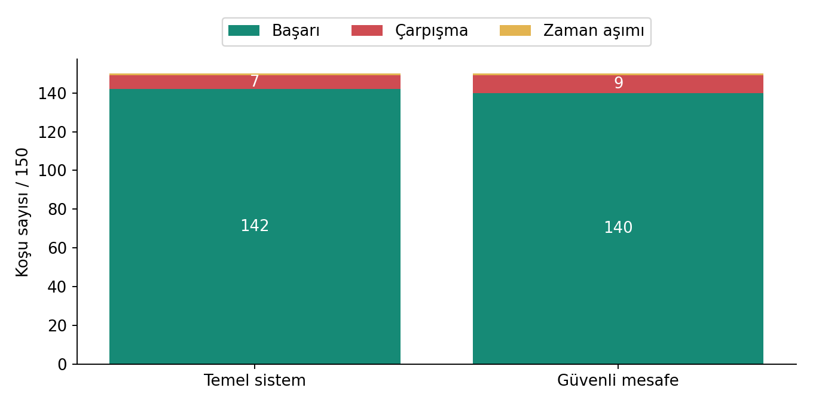
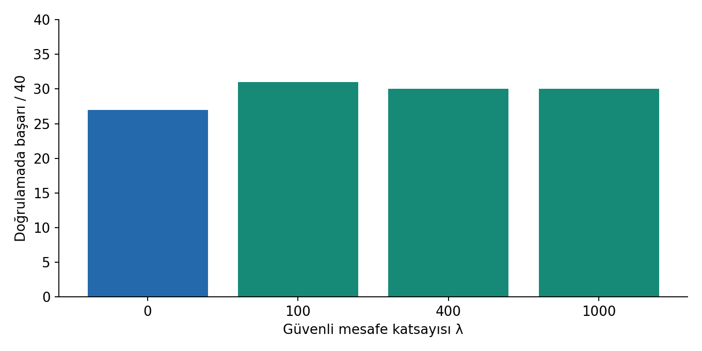

# 1. Introduction / Giriş

Bulanık sinir ağı ve genetik algoritma ile robot navigasyonu: güvenli mesafe cezasının kontrollü değerlendirmesi

Emirhan Efe Demir · 1306230024 · Atanan makale: 16 · 16 Kasım 2026

Bu proje, Jiawei Zhang’ın 2025 tarihli çalışmasının [1] bulanık kontrol bileşenini yeniden kurar ve robotun engellere fazla yaklaşmasını cezalandıran bir uygunluk terimini değerlendirir. Amaç, yalnızca hareket eden bir robot göstermek değil, yöntemin hangi kısmının kaynakla desteklendiğini ve hangi kısmının uygulama varsayımı olduğunu açıkça ayırmaktır. Sistem Python ile CPU üzerinde çalışır ve harita, model, deney ayarları ile ham sonuçları kaydeder.

Temel araştırma sorusu, sürekli açıklık cezasının çarpışma ve hedefe ulaşma oranlarını değiştirirken yol uzunluğu ve süreyi nasıl etkilediğidir. Deney 5 bağımsız eğitim tohumu ve 30 ortak test haritası içerir. Doğrulama sonucunda seçilen katsayı 100’dür. Temel sistem 142/150, geliştirilen sistem 140/150 başarı elde etmiştir. Geliştirme, ortalama minimum açıklıkta küçük artışa rağmen çarpışmayı azaltmamıştır. Bu olumsuz bulgu, daha güvenli görünen bir eğitim hedefinin testte kendiliğinden daha güvenli davranış üretmediğini göstermektedir.

## 2. Related Work / İlgili çalışmalar

Teng ve arkadaşları [2], iki katmanlı bulanık kontrol ile yol ve görev güvenlik seviyelerinden GA uygunluk ağırlıkları üretir. Stavrinidis ve arkadaşları [3], GA’yı çoklu hedef sıralamasında kullanırken bulanık kontrolcüleri takip ve dinamik engelden kaçınmaya ayırır. Bu projenin tek hedefli, sabit katsayılı kontrolcü evrimi her iki çalışmadan farklı bir deney düzenidir. Bu iki kaynak için yayıncı özetleri ve künyeleri incelenmiştir; yöntemlerin bütün deney ayrıntıları doğrulanmış kabul edilmez.

Jang’ın adaptif bulanık sistem çalışması [4], kurallarla sayısal öğrenmenin birlikte ele alınmasına teorik temel sağlar. Ancak burada Jang’ın hibrit öğrenmesi uygulanmaz. Gaussian öncüllerin merkezleri ve genişlikleri sabittir; GA yalnızca çıkış ağırlıklarını arar. Güvenlik cezası literatürde yeni değildir. Proje katkısı, atanan makalenin yorumlanmış temel sistemi üzerinde tek değişkenli, tekrar üretilebilir bir genişletme ve duyarlılık analizidir.

Yönergedeki minimum yeniden gerçekleştirme kapsamı bu raporda önerilen teknik kapsamdır; öğretim elemanının onayı alınmış gibi sunulmamaktadır. Kaynakta eksik olan veri ve ölçüt tanımları nedeniyle birebir sonuç tekrarına ilişkin gereksinim kısmen karşılanır.

# 3. Theoretical Background / Teorik altyapı

Bulanık küme, bir girdinin dilsel kavrama aitliğini 0 ile 1 arasında ifade eder. Örneğin 1.5 m engel açıklığı, seçilen ölçeğe göre hem “yakın” hem “uzak” kümelerini etkinleştirebilir. Üyelik derecesi olasılık değildir. Gaussian biçim, merkezden uzaklaştıkça yumuşak azalan ve her sonlu girdide negatif olmayan bir eşleşme sağlar.

μij(xi) = exp[-((xi - cij)/σi)²]

Burada i girdiyi, j o girdinin dilsel kümesini, c merkezi, σ pozitif genişliği gösterir. İlk üç girdi ön/sol/sağ açıklıktır: 3 m’de kırpılır ve 3’e bölünür. Hedef açısı [-π,π) aralığına sarılıp π’ye bölünür. Hedef uzaklığı 10 m’de kırpılır ve 10’a bölünür. Böylece ölçek farkları üyelik karşılaştırmasını bozmaz.

| Girdi | Normalize merkezler | Genişlik |
| --- | --- | --- |
| Ön / sol / sağ | 0, 1 | 0.42 |
| Hedef açı hatası | -1, -0.5, 0, 0.5, 1 | 0.30 |
| Hedef uzaklığı | 0, 1 | 0.55 |

Bütün dilsel kombinasyonlar 2×2×2×5×2=80 kural oluşturur. Her kural beş öncülün minimumunu kullanır. Bu işlem “ve” bağlacının min t-norm yorumudur. Sonra kurallar toplam etkinliğe bölünür. Toplam sayısal olarak sıfıra yaklaşırsa eşit ağırlık kullanılır; böylece tanımsız bölme engellenir.

αr = mini μi,j(r,i)(xi),     ᾱr = αr / Σk αk

yl = Σr=1..80 ᾱr wrl,     l : {hız, dönüş}

Ağırlıklar [-1,1] aralığındadır. Doğrusal çıktı [0,1] aralığına kırpılıp 0.8 m/s ile; açısal çıktı [-1,1] aralığına kırpılıp 1 rad/s ile ölçeklenir. Sabit kural sonuçlarının ağırlıklı ortalaması Sugeno benzeri bir yorumdur. Mamdani çıktı kümelerinin alan merkezi hesaplanmaz. Öğrenme 80×2=160 ağırlığı değiştirir; üyelikler sabit kaldığından tam adaptif öncül öğrenmesi yoktur.

Uzman öncülü, ön engel yakınsa daha açık yana dönmeyi ve hızı azaltmayı, yol açıksa hedef açı hatasına göre yönelmeyi kodlar. Başlangıç popülasyonu bu öncülün etrafında rastgele örneklenir. Öncül tek başına eğitilmiş model değildir; GA seçiliminden geçen parametreler models/full dosyalarında saklanır.

# 4. Original Method / Referans yöntem

Kaynak [1], beş katmanlı FNN’nin Gaussian bulanıklaştırma, minimum, normalizasyon ve ağırlıklı çıktı adımlarını denklemler (1)-(4) ile sunar. GA bölümünde gerçek değerli bağlantı ağırlıkları kromozom olarak tanımlanır; turnuva boyutu 4, nöron sınırlarında iki noktalı çaprazlama ve sınırlı değişim açıklanır. Bu ayrıntılar yeniden kurulan sistemin ana dayanağıdır.

f = (7000 - t) + (1200 - d) + qv/30 + qs/20

Kaynağın denklem (9)’unda t hedefe ulaşma süresi, d duruş anındaki hedef uzaklığı olarak anlatılır; qv ve qs’nin ayrı operasyonel tanımları eksiktir. Başarısız koşuların nasıl ele alındığı ve mesafe-zaman birimleri de açıklanmaz. Bu nedenle formülü çalıştırmak için ek seçimler gereklidir. Bu seçimler kaynak sonuçlarının aynısını ürettiği varsayımıyla kullanılamaz.

Tam metin ve PDF görüntüsü kontrolü önemli sorunlar göstermiştir. Gaussian adı verilen denklem (1), exp ve eksi işareti içermeyen kareli uzaklıktır. Hedef koordinatı (570570570) olarak basılmıştır. Tekerlek “kuvvetleri” ile açı artışı/hız arasında boyutları açıklanmayan doğrudan ilişki kurulmuştur. Daha sonraki anlatım kromozomu yol düğümleri olarak tanımlayarak ağırlık kromozomu açıklamasından ayrılır. FNN-GA çift yönlü geri besleme iddiasının uygulanabilir güncelleme denklemleri yoktur.

Navigasyon deneyi 40 statik/dinamik engel ve 500 örnekten söz eder. BPNN, SOM, ART ile karşılaştırma verilir. Şekil 4 başlığı doğruluk olmasına rağmen çizilen eksen süre ve değerler Şekil 5 zamanlarıyla uyumludur. Bu raporda doğruluk sayıları grafik ölçümü olarak değil, metinde bildirilen kaynak sonuçları olarak ele alınır. Özetteki en kısa 9.64 s ifadesi de hedef 3 için metinde verilen 8.68 s ile uyuşmaz.

| Kaynak konumu | Bildirilen değer | Bizim ölçütümüzle ilişki |
| --- | --- | --- |
| Hedef 1, metin | %98.64 accuracy | Başarı oranıyla eşitlenmez |
| Hedef 1, Şekil 5 | 9.64 s | Farklı fizik ve koşullar |
| Hedef 2, Tablo 1 | %1.52 sapma | Açı hata tanımı eksik |
| 0 engel, Tablo 2 | %99.12 verim | Operasyonel tanım eksik |

Data availability bölümü veri için yazara başvurulmasını ister. Makale içinde resmi kod deposu bağlantısı tespit edilmemiştir. Haritalar, bütün ağ parametreleri ve özgün deney örnekleri elde olmadan sayısal eşleşme doğrulanamaz. Lisans CC BY-NC-ND 4.0’dır; kaynak PDF ve makale görselleri bu pakette yeniden dağıtılmaz.

# 5. Reproduction Methodology / Yeniden gerçekleştirme

Uygulama, kaynakta daha ayrıntılı verilen ağırlık kromozomu yorumunu seçer. FNN çıkışlarını yol kromozomuna dönüştüren ikinci mekanizma kullanılmaz. Ağ katmanlarının sırası korunur; üyelik denklemi geçerli Gaussian biçimiyle tamamlanır. Girdi sayıları, üyelik merkezleri, genişlikler ve bütün kural kombinasyonları proje kararlarıdır. Aynı kararlar baseline ve proposed için aynıdır.

Fizik ortamı 10×10 m’dir. Robot 0.18 m yarıçaplı bir disk, engeller 0.25–0.55 m yarıçaplı statik dairelerdir. Adım 0.2 s, en fazla 250 adım, hedef toleransı 0.30 m’dir. Başlangıç x=0.6 m, hedef x=9.4 m, y konumları tohumla üretilir. Engel merkezleri x=1.7–8.3 m ve y=0.8–9.2 m arasında seçilir. Dolayısıyla bu, genel depoları temsil eden tarafsız bir harita dağılımı değildir.

θk+1 = wrap(θk + ωkΔt)

pk+1 = pk + vkΔt [cos θk+1, sin θk+1]

Her sayısal adım düz doğru parçası olarak kabul edilir. Bu parçaya engel merkezinin minimum uzaklığından engel ve robot yarıçapları çıkarılarak çarpışma kontrol edilir. Böylece uç noktaları güvenli olsa bile engelin içinden atlama yakalanır. Bu hesap parçalı doğrusal modele göre kesindir; sürekli diferansiyel sürüş yayı için tam fizik doğruluğu iddiası değildir. Dünya sınırı da robot yarıçapıyla kontrol edilir.

Harita geçilebilirliği 0.2 m ızgarada dört komşulu BFS ile, her kenarın süpürülen disk açıklığı doğrulanarak kontrol edilir. Bu arama kontrolcüye yol vermez. Yalnızca geçilebilir haritaları seçer. Izgara çözünürlüğü nedeniyle gerçekten geçilebilir dar bir haritayı reddedebilir; bu da deney dağılımını kolaylaştırabilir.

Seçilen temel deney, kaynağın “Path planning experiment” bölümündeki Şekil 6/Tablo 2 engel sayısı taramasıdır. 0,2,4,6,8,10 engel için ayrı haritalarda beşer GA çalıştırılmıştır. Sonuçlar paper_approximation.csv içindedir. Orijinal harita, Visual C++ 6.0 donanımı ve süre tanımı bilinmediğinden bu yaklaşık tekrar, yayın sürelerini doğrulamaz. Buradaki harita üzerinde eğitim değerlendirmesi ana genelleme testinden ayrıdır.

Kontrolcüde tekerlek kuvveti yerine v ve ω kullanılır. İdeal diferansiyel sürüş dönüşümü vL=v-bω/2 ve vR=v+bω/2’dir; b dingil açıklığıdır. Simülasyonun bu dönüşüme ihtiyacı yoktur ve motor, kayma, ivmelenme veya tekerlek dinamiği içermez.

# 6. Proposed Extension / Önerilen geliştirme

Temel uygunluk denkleminde çarpışmasız adımlar zaten ödüllendirilmektedir. Yeni terim, çarpışmadan önce riskli yakın geçişleri de ayırt eden sürekli bir açıklık cezasıdır. Robot ve engel yüzeyleri arası minimum açıklık c, güvenli eşik c*=0.6 m olmak üzere her adımın kareli açığı hesaplanır. Dünya sınırları da c içinde bulunduğundan bu terim yalnızca engel mesafesini değil, sınır açıklığını da kapsar.

P = (1/K) Σk=1..K max(0, (0.6 - ck)/0.6)²

Fλ = F0 - λP

K koşunun gerçekleşen adım sayısıdır. Ortalama alınması yalnızca uzun sürdüğü için bir yolun daha büyük ceza biriktirmesini azaltır. Bununla birlikte aynı ortalama, kısa fakat çok riskli bir bölgeyi diğer adımlarla seyreltebilir. Bu seçim güvenlik garantisi sağlamaz. Sabit lambda ve güvenli eşik, açıklık-süre-başarı dengesini değiştiren hiperparametrelerdir.

## 7. Experimental Setup / Deney düzeni

Temel formülün uygulama yorumu: t başarılı koşuda adım sayısı, başarısız koşuda 7000; d son hedef uzaklığının 60 katı; qv çarpışmasız ve |Δθ|<0.1 olan adım sayısı; qs bütün çarpışmasız adımlar. Başarısızlık için 7000 değeri, erken çarpışmanın kısa süre nedeniyle ödüllendirilmesini önleyen proje seçimidir. Bu ölçekler makaleden doğrulanmış birim dönüşümü değildir.

| Ayar | Değer |
| --- | --- |
| Eğitim / doğrulama / test haritaları | 8 / 8 / 30, ayrık tohumlar |
| Bağımsız GA tohumları | 11, 22, 33, 44, 55 |
| Popülasyon / nesil / elit | 20 / 20 / 2 |
| Turnuva / gen mutasyon olasılığı | 4 / 0.12 |
| Lambda adayları | 0, 100, 400, 1000 |
| Model başına bütçe | 3200 harita değerlendirmesi |

İki noktalı çaprazlama kural bloklarının sınırlarında yapılır. Mutasyon en büyük adımı nesillerle azaltır ve ağırlıkları [-1,1] aralığında tutar. Başlangıç popülasyonları ve rastgele dizi aynı tohumda lambda’lar arasında eşleştirilmiştir. Katsayı pozitif adaylardan doğrulama başarısı, daha az çarpışma, daha yüksek açıklık ve daha küçük lambda sırasıyla seçilir. Test haritaları bu karara katılmaz. Çalışma Python 3.12.0 ve NumPy 1.26.4 ile Windows üzerinde yürütülmüştür. quick modu ayrı dosyalara yazar.

# 8. Results / Sonuçlar

| Ölçüt | Baseline | Proposed (λ=100) |
| --- | --- | --- |
| Başarı | 142 / 150 | 140 / 150 |
| Çarpışma | 7 / 150 | 9 / 150 |
| Zaman aşımı | 1 / 150 | 1 / 150 |
| Tohum başarı oranı ort. ± SS | %94.67 ± 2.98 puan | %93.33 ± 4.71 puan |
| Min. açıklık, tüm koşular ort. | 0.2725 m | 0.2786 m |
| Yol, yalnız başarılı koşular | 10.4504 m (n=142) | 10.3804 m (n=140) |
| Süre, yalnız başarılı koşular | 20.2493 s | 19.5257 s |

Paydalar beş eğitimin aynı 30 test haritasındaki toplamıdır. 150 koşu, 150 bağımsız eğitim deneyi değildir. Başarı oranı standart sapması beş tohum üzerinden hesaplanır. İki yöntemin de başarılı olduğu 135 eşleşmiş koşuda proposed eksi baseline yol farkı -0.0347 m’dir. Başarıya koşullu ortalama yoldaki -0.0700 m farkı, farklı başarılı alt kümelerden de etkilenir.

Model başına GA eğitim süresi baseline 3.529 ± 0.510 s, proposed 3.559 ± 0.467 s ölçülmüştür. Tek satırlı kontrolcü çağrılarının medyanı sırasıyla yaklaşık 36.6 ve 32.8 µs’dir. Bu mikro ölçüm sensör/arayüz maliyetini içermez. Donanım yüküne bağlı gerçek süreler, simülasyon saniyesinden ve makalenin planlama süresinden farklıdır.

# 9. Discussion / Tartışma

Güvenli mesafe terimi testte ortalama minimum açıklığı yaklaşık 6.1 mm artırmıştır. Ancak başarı iki koşu düşmüş ve çarpışma iki koşu artmıştır. Bu sonuç, katkının testte daha güvenli olduğunu desteklemez. Beş eğitim tekrarı küçük bir örneklem olduğundan farkların istatistiksel anlamlı olduğu söylenemez. Aynı haritaların bütün tohumlarda kullanılması harita ve model belirsizliğini iç içe geçirir.

Pozitif katsayıların doğrulamadaki başarı sayıları birbirine yakındır. Seçim kuralı lambda=100’ü belirlemiştir. Test sonucunu gördükten sonra daha iyi görünen bir katsayı seçilmemiştir. Eğitim haritalarının azlığı, uzman öncülünün oluşturduğu başlangıç yanlılığı ve düşük nesil sayısı genelleme farkının olası nedenleridir. Bunlar deneyle ayrı ayrı doğrulanmış nedensel açıklamalar değildir.

Güvenli açıklık ödülü ile hedefe ulaşma arasında bir ödünleşim vardır. Engel çevresinde daha geniş dönüş güvenlik payını artırabilir, fakat hedefin çevresinde dönmeye veya zaman aşımına yol açabilir. Sensör vektöründe dünya duvarlarının bulunmaması da sınıra yaklaşırken yeterli uyarı üretmeyebilir. Güvenlik teriminin bütün adımlar üzerinde ortalama olması yerel riskleri saklayabilir.

Yakınsama eğrisi her neslin en iyi uygunluk değerini ve tohumlar arası standart sapmayı gösterir. Farklı lambda’lar farklı amaç fonksiyonları kullandığı için eğrilerin mutlak yükseklikleri doğrudan performans sıralaması değildir. Test başarı/çarpışma ve ortak başarılı koşu karşılaştırması asıl değerlendirmedir. Sonraki çalışma, eğitim haritası sayısı ve popülasyon bütçesini yalnızca yeni bir deney protokolünde artırmalıdır.

# 10. Limitations / Sınırlılıklar

Çalışma orijinal yöntemin sayısal birebir tekrarı değildir. Kaynak veri, tam kural tablosu, ağ parametreleri, haritalar ve ölçüt tanımları eksiktir. Gaussian ifade gerekçeli biçimde tamamlanmış, farklı koordinat ve hareket modeli seçilmiştir. FNN-GA çevrim içi geri beslemesi, BPNN/SOM/ART karşılaştırmaları, 40 dinamik engelli depo ve 500 örneklik deney uygulanmamıştır. Minimum yeniden gerçekleştirme gereksiniminin birebir deney kısmı bu nedenle kısmi kalır.

Sentetik dairesel engeller, ideal gözlem ve sabit robot boyutu fiziksel gerçekliği sınırlar. Başlangıç-hedef x düzeni ve geçilebilirlik filtresi harita çeşitliliğini azaltır. Ağın öncülleri sabittir. Öğrenme bütçesi küçüktür ve istatistiksel çıkarım yalnızca betimseldir. Çarpışma kontrolü sayısal doğru parçaları için geçerlidir. Demo fiziksel bir robota doğrudan sürüş komutu vermek için doğrulanmamıştır.

## 11. Conclusion / Sonuç

Beş katmanlı bulanık denetleyici, GA ile çıkış ağırlığı öğrenimi, açıklanabilir canlı demo ve tekrar üretilebilir deney hattı gerçekleştirilmiştir. Yaklaşık engel sayısı taraması ve ayrı genelleme deneyi çalıştırılmıştır. Güvenli mesafe cezası ortalama açıklığı az miktarda artırsa da testte çarpışmayı azaltmamıştır. Katkının değeri, başarı iddiasından çok bu etkinin adil ve görünür biçimde ölçülmesidir.

Gelecek çalışma için önceden tanımlanmış yeni protokolde daha geniş eğitim haritaları, duvar algısı, gürültü, dinamik engeller ve minimum açıklığa odaklı farklı risk özetleri değerlendirilebilir. Makale verileri elde edilirse ayrıca gerçek bir tekrar planlanmalıdır. Aynı test setine sürekli ayar yapmak bağımsız test özelliğini kaybettirir.

## Generative AI Usage Disclosure

ChatGPT/Codex; makale incelemesi, kaynak araması, kod yazımı, hata ayıklama, deney yürütme, grafik, rapor ve sunum taslağı üretiminde kapsamlı olarak kullanılmıştır. Dosyalardaki deneyler araç ortamında gerçekten çalıştırılmıştır. Öğrencinin bütün kodu ve bulguları henüz bağımsız olarak doğruladığı ileri sürülmemektedir. Öğrenci, teslim öncesinde yöntemi incelemeli, komutları kendi ortamında çalıştırmalı ve çıktıları açıklayabilmelidir.

Teslim durumu: Yerel Git deposu ve gerçek aşama commit’leri hazırlanmıştır. GitHub’a yükleme ve Classroom teslimi yapılmamıştır. Öğretim elemanı kapsam onayı alınmamıştır. Sunum PDF ve düzenlenebilir HTML kaynağı sağlanır; PPTX üretimi mevcut çalışma ortamındaki bağımlılık erişim hatası nedeniyle tamamlanamamıştır. Masaüstü demo işlevleri programatik kontrol edilmiştir; ekran yakalama engeli nedeniyle görsel masaüstü denetimi tamamlanamamıştır.

# References / Kaynaklar

[1] J. Zhang, “Application and development of artificial intelligence and computer technology in the field of intelligent robots,” Scientific Reports, vol. 15, art. 14656, 2025. doi: 10.1038/s41598-025-93926-1. https://www.nature.com/articles/s41598-025-93926-1

[2] Y. Teng, T. Feng, C. Song, J. Li, S. X. Yang, and H. Zhu, “Path Planning of Mobile Robot Based on Dual-Layer Fuzzy Control and Improved Genetic Algorithm,” Symmetry, vol. 17, no. 4, art. 609, 2025. doi: 10.3390/sym17040609. https://www.mdpi.com/2073-8994/17/4/609

[3] S. Stavrinidis, P. Zacharia, and E. Xidias, “A Fuzzy Control Strategy for Multi-Goal Autonomous Robot Navigation,” Sensors, vol. 25, no. 2, art. 446, 2025. doi: 10.3390/s25020446. https://www.mdpi.com/1424-8220/25/2/446

[4] J.-S. R. Jang, “ANFIS: Adaptive-Network-Based Fuzzy Inference System,” IEEE Transactions on Systems, Man, and Cybernetics, vol. 23, no. 3, pp. 665-685, 1993. doi: 10.1109/21.256541. https://www.cic.ipn.mx/~pescamilla/SistInt/Jang1993.pdf
